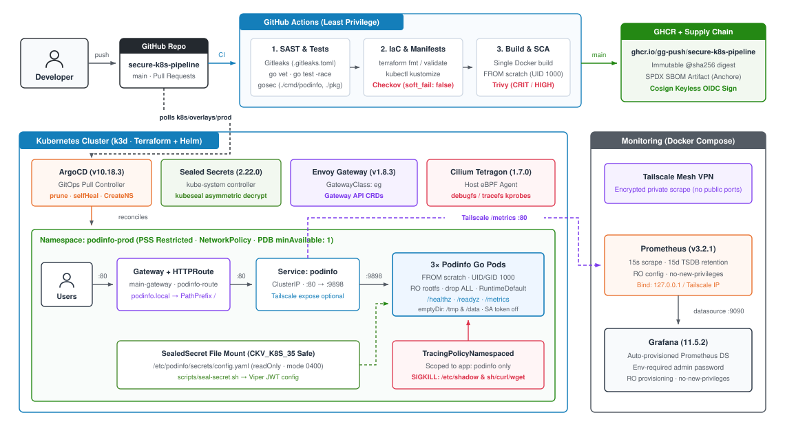

# Zero-Trust DevSecOps Kubernetes Pipeline (`secure-k8s-pipeline`)

[](https://github.com/gg-push/secure-k8s-pipeline/actions/workflows/ci.yml)

Production-hardened DevSecOps CI/CD pipeline and pull-based GitOps stack deploying a static `FROM scratch` Go microservice (`podinfo`) onto Kubernetes (`k3d` via Terraform & Helm), guarded by Shift-Left SAST/IaC/SCA gates, keyless Cosign digest signing, Envoy Gateway API, Sealed Secrets, and namespaced Cilium Tetragon eBPF runtime enforcement.

---

## Architecture



---

## Security & Supply-Chain Controls

| Layer | Control | Implementation |
|---|---|---|
| **Secret & Code SAST** | Full-history secret scan + Go static analysis | `Gitleaks` (`.gitleaks.toml`), `go vet`, `go test -race`, `gosec` (`./cmd/podinfo/... ./pkg/...`) |
| **IaC & Manifest Gate** | Blocking Terraform, Kustomize & policy scan | `terraform fmt/validate`, `kubectl kustomize`, `Checkov` (`soft_fail: false`, `.checkov.yml`) |
| **Container & Supply Chain** | Single-build SCA + immutable digest signing | `FROM scratch` (`USER 1000`), `Trivy` (`CRITICAL/HIGH`), `@sha256` push, SPDX SBOM, keyless `Cosign` |
| **Pod Security (Restricted)** | Zero-privilege container runtime | `automountServiceAccountToken: false`, `readOnlyRootFilesystem: true`, `drop: ["ALL"]`, `RuntimeDefault` seccomp |
| **Network Isolation** | Default-deny pod ingress/egress | `NetworkPolicy` allows `:9898` only from same-ns and `envoy-gateway-system`; DNS `:53` egress |
| **Secrets Management** | Asymmetric GitOps encryption + file mount | `sealed-secrets-controller` (`kube-system`), `scripts/seal-secret.sh`, read-only `0400` file mount (no env var secrets) |
| **eBPF Runtime Security** | Kernel-level syscall/file enforcement | `TracingPolicyNamespaced` scoped strictly to `app: podinfo` (`SIGKILL` on `/etc/shadow` or any exec outside `/podinfo` via `security_bprm_check`) |

---

## Environments (Kustomize Overlays)

| Overlay | Namespace | Replicas | Availability | Hostname (`HTTPRoute`) |
|---|---|---|---|---|
| `k8s/overlays/dev` | `podinfo-dev` | `1` | Single pod | `dev.podinfo.local` |
| `k8s/overlays/prod` | `podinfo-prod` | `3` | `PodDisruptionBudget` (`minAvailable: 1`) | `podinfo.local` |

Cluster-scoped [`k8s/cluster/gatewayclass.yaml`](k8s/cluster/gatewayclass.yaml) is applied once at bootstrap so `dev` and `prod` overlays stay completely isolated.

---

## Repository Layout

```text
secure-k8s-pipeline/
├── .github/workflows/ci.yml            # Gitleaks, go vet/test -race/gosec, Checkov, Trivy, SBOM & Cosign
├── .gitleaks.toml / .checkov.yml       # Documented test-token allowlist & Checkov policy configuration
├── app/
│   ├── Dockerfile                      # Multi-stage golang:1.26-alpine -> scratch (non-root UID 1000)
│   └── cmd/ & pkg/                     # Go HTTP/gRPC microservice (/healthz, /readyz, /metrics)
├── docs/architecture.svg               # End-to-end SecOps & GitOps architecture diagram
├── k8s/
│   ├── argocd-app.yaml                 # Root ArgoCD Application (podinfo-prod, prune + selfHeal)
│   ├── cluster/gatewayclass.yaml       # Cluster-scoped Envoy GatewayClass (eg)
│   ├── base/                           # PSS-Restricted Deployment, Service, NetworkPolicy, Tetragon, Gateway
│   └── overlays/{dev,prod}/            # Isolated namespace overlays + prod PodDisruptionBudget
├── scripts/seal-secret.sh              # Helper to encrypt podinfo-secrets via kubeseal
└── terraform/main.tf                   # 2-stage k3d bootstrap + ArgoCD, Sealed Secrets, Tetragon & Envoy Helm charts
```

---

## Quickstart 1: Local Cluster ($0 via `k3d` + Terraform)

Requires Docker, `k3d`, `kubectl`, and Terraform `>= 1.10`.

```bash
# 1. Create k3d cluster with debugfs/tracefs bind-mounted for Cilium Tetragon
terraform -chdir=terraform init
terraform -chdir=terraform apply -target=null_resource.k3d_cluster -auto-approve

# 2. Install ArgoCD, Sealed Secrets, Tetragon, Envoy Gateway, and apply GitOps manifests
terraform -chdir=terraform apply -auto-approve

# 3. Teardown cluster and generated kubeconfig when done
terraform -chdir=terraform destroy -auto-approve
```

## Quickstart 2: Sealing a Secret (`kubeseal`)

[`deployment.yaml`](k8s/base/deployment.yaml) mounts `podinfo-secrets` read-only at `/etc/podinfo/secrets/config.yaml` (`optional: true`, mode `0400`). To seal and enable a real JWT secret for an environment:

```bash
./scripts/seal-secret.sh prod
# Add `- sealed-secret.yaml` to k8s/overlays/prod/kustomization.yaml and commit
```
