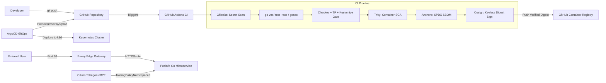

# Secure K8s Deployment Pipeline

Production-grade DevSecOps CI/CD pipeline, GitOps deployment, and runtime-hardened Kubernetes stack for a Go microservice (`podinfo`).

## Enterprise Architecture



## Phase 1: Application & Hardened Multi-Stage Container

- **Base Application**: Go microservice (`app/`) exposing `/healthz`, `/readyz`, and Prometheus `/metrics` on port `9898`.
- **Multi-Stage `FROM scratch` Build** ([app/Dockerfile](app/Dockerfile)):
  1. **Builder (`golang:1.26-alpine`)**: Installs CA certificates and builds a statically linked multi-arch binary (`CGO_ENABLED=0`, `-trimpath -ldflags="-w -s"`).
  2. **Runtime (`FROM scratch`)**: Copies only `/podinfo`, `/ui`, and `/etc/ssl/certs/ca-certificates.crt`, running as non-root `USER 1000:1000` with zero shell or package manager attack surface.

## Phase 2: Shift-Left SecOps CI Pipeline

[`.github/workflows/ci.yml`](.github/workflows/ci.yml) enforces strict, blocking security gates with least-privilege permissions (`contents: read` at workflow level):

1. **Secret Scanning (`Gitleaks`)**: Scans full Git history (`fetch-depth: 0`) using [`.gitleaks.toml`](.gitleaks.toml) to allowlist only documented dummy unit-test tokens.
2. **Go Static Analysis & Tests**: Runs `go vet ./...`, `go test -race -v ./...`, and `gosec` directly inside `./app`.
3. **IaC & Manifest Gate**: Validates `terraform fmt -check`, `terraform validate`, `kubectl kustomize` builds for both `dev` and `prod` overlays, and runs **Checkov** (`soft_fail: false` via [`.checkov.yml`](.checkov.yml)).
4. **Single-Build & Trivy SCA**: Builds the image once (`:<sha>` and `:latest`) and fails the pipeline if `CRITICAL` or `HIGH` OS/library CVEs exist.
5. **Immutable Digest Push, SBOM & Cosign**: On `main`, pushes the exact scanned image, captures its `@sha256:...` digest, uploads an SPDX SBOM artifact (`sbom.spdx.json`), and signs the immutable digest via keyless **Cosign**.

## Phase 3: Pod Security Standard (Restricted) & Network Isolation

All base manifests live in [`k8s/base/`](k8s/base/):
- **Pod & Container Hardening** ([`deployment.yaml`](k8s/base/deployment.yaml)): `automountServiceAccountToken: false`, `runAsNonRoot: true`, `runAsUser/Group/fsGroup: 1000`, `seccompProfile: RuntimeDefault`, `allowPrivilegeEscalation: false`, `readOnlyRootFilesystem: true`, `capabilities.drop: ["ALL"]`, with `emptyDir` mounts at `/tmp` and `/data`.
- **Zero-Trust NetworkPolicy** ([`networkpolicy.yaml`](k8s/base/networkpolicy.yaml)): Restricts ingress on TCP `9898` to same-namespace pods plus `envoy-gateway-system`, `tailscale`, and `monitoring` namespaces, and restricts egress to `kube-system` DNS (`53`).
- **Availability (`prod`)**: [`k8s/overlays/prod/pdb.yaml`](k8s/overlays/prod/pdb.yaml) enforces `PodDisruptionBudget` (`minAvailable: 1`) across the 3 production replicas.

## Phase 4: GitOps Secrets Management (Sealed Secrets)

Terraform installs the **Bitnami Sealed Secrets** controller in `kube-system`. Generate and encrypt a real `PODINFO_JWT_SECRET` for either environment using [`scripts/seal-secret.sh`](scripts/seal-secret.sh):

```bash
chmod +x scripts/seal-secret.sh
./scripts/seal-secret.sh prod
```

Then add `- sealed-secret.yaml` to `k8s/overlays/prod/kustomization.yaml` and commit. [`deployment.yaml`](k8s/base/deployment.yaml) mounts `podinfo-secrets` read-only at `/etc/podinfo/secrets/config.yaml` (`optional: true`, mode `0400`) so pods start cleanly before sealing and automatically load the decrypted secret file without exposing secrets as environment variables.

## Phase 5–7: ArgoCD GitOps, Gateway API & Multi-Env Kustomize

- **Cluster-Scoped GatewayClass**: [`k8s/cluster/gatewayclass.yaml`](k8s/cluster/gatewayclass.yaml) defines the Envoy GatewayClass once at the cluster level.
- **Namespace-Isolated Overlays**:
  - `k8s/overlays/dev` → namespace `podinfo-dev`, `1` replica, hostname `dev.podinfo.local`.
  - `k8s/overlays/prod` → namespace `podinfo-prod`, `3` replicas, `PodDisruptionBudget`, hostname `podinfo.local`.
- **ArgoCD Handover**: [`k8s/argocd-app.yaml`](k8s/argocd-app.yaml) deploys `k8s/overlays/prod` into `podinfo-prod` with `prune: true`, `selfHeal: true`, and `CreateNamespace=true`.

## Phase 8: Namespaced eBPF Runtime Security (Cilium Tetragon)

[`k8s/base/tetragon-policy.yaml`](k8s/base/tetragon-policy.yaml) uses **`TracingPolicyNamespaced`** scoped strictly via `podSelector: { matchLabels: { app: podinfo } }` in the target namespace (`podinfo-dev` or `podinfo-prod`). Any unexpected attempt inside a `podinfo` container to open `/etc/shadow` or `execve` `/bin/sh`, `/bin/bash`, `curl`, or `wget` triggers kernel-level `SIGKILL` without impacting system or ArgoCD pods.

## Phase 9: Hardened Monitoring Stack (Prometheus + Grafana over Tailscale)

[`monitoring/`](monitoring/) provides a decoupled Docker Compose stack with pinned versions (`prom/prometheus:v3.2.1`, `grafana/grafana:11.5.2`), `no-new-privileges:true`, read-only config mounts, localhost/Tailscale binding (`MONITORING_BIND_IP`), auto-provisioned Prometheus datasource, and required admin credentials:

```bash
cd monitoring
cp .env.example .env
# Edit .env with a strong GRAFANA_ADMIN_PASSWORD (and Tailscale bind IP if remote)
# Update monitoring/prometheus.yml with your podinfo Tailscale MagicDNS host or IP
docker compose up -d
```

## How to Deploy Locally ($0 via k3d + Terraform)

Requires Docker, `k3d`, `kubectl`, and Terraform `>= 1.10`.

1. **Bootstrap the `k3d` cluster** (bind-mounts `/sys/kernel/debug` and `/sys/kernel/tracing` for Tetragon):
   ```bash
   cd terraform
   terraform init
   terraform apply -target=null_resource.k3d_cluster -auto-approve
   ```
2. **Install ArgoCD, Sealed Secrets, Tetragon, Envoy Gateway, and apply GitOps manifests**:
   ```bash
   terraform apply -auto-approve
   ```
3. **Teardown when finished** (deletes `k3d` cluster and generated kubeconfig):
   ```bash
   terraform destroy -auto-approve
   ```
